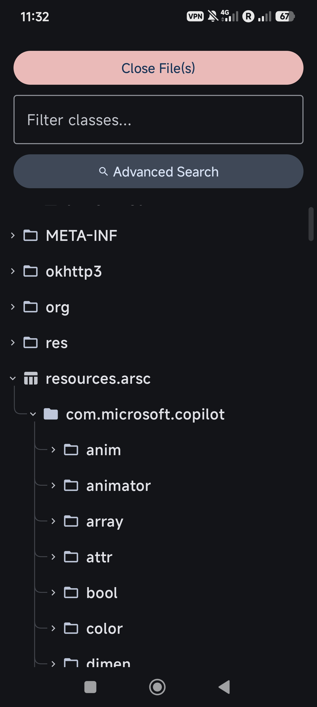
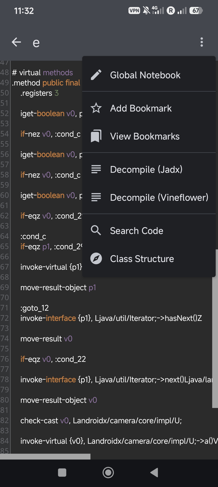
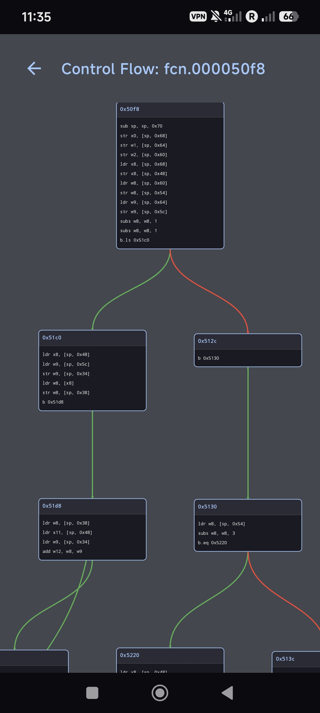
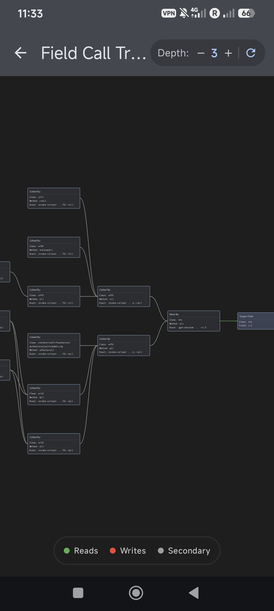
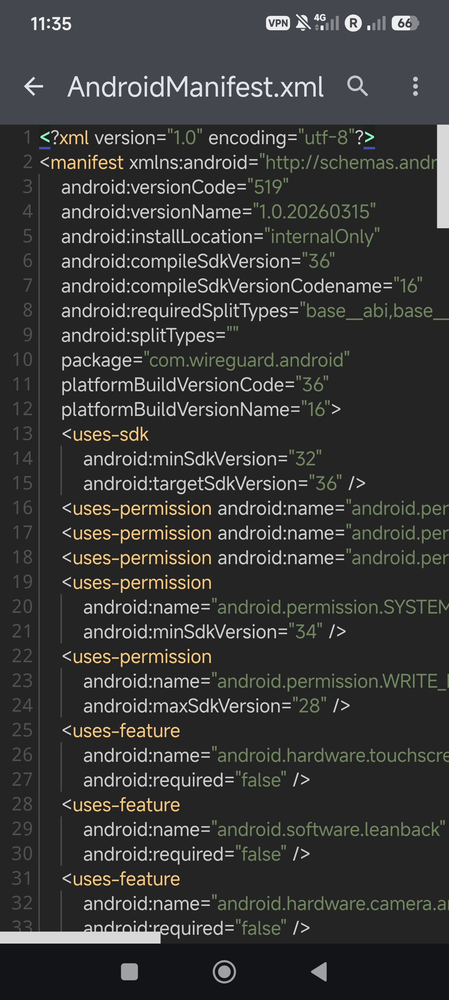
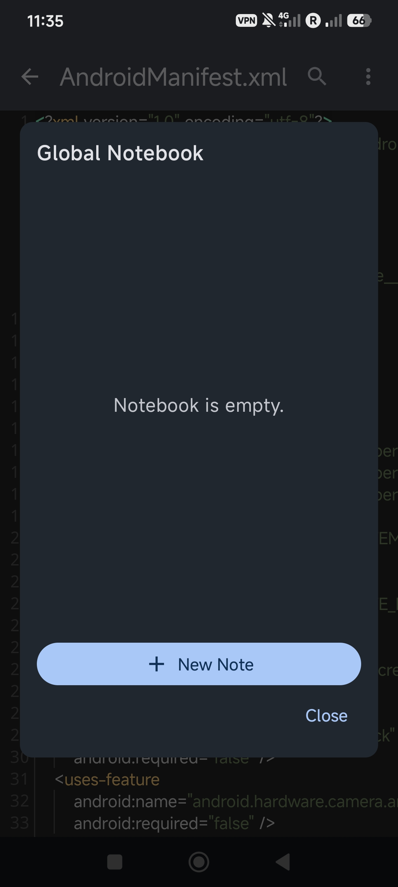

# Android Reverse

A reverse engineering suite that runs entirely on Android. No PC, no ADB, no desktop tools — everything from APK extraction to native binary analysis, editing, and rebuilding happens on-device.

---

## MCP Server

androidReverse includes a built-in [Model Context Protocol](https://modelcontextprotocol.io) server, allowing MCP-compatible AI clients to connect and edit resources, AXML, the manifest, and Smali directly within a project. Compilation/rebuild remains a manual, user-triggered step.

---

## Java Decompilation

Eight engines selectable per-class with a single tap:

| Engine | Notes |
|--------|-------|
| **CFR** | Handles most modern obfuscation well |
| **Procyon** | Good with generics and lambdas |
| **JD-Core** | Fast, lightweight |
| **Krakatau** | Bytecode-level accuracy |
| **Vineflower** | Fernflower fork, strong on control flow |
| **Jadx** | Primary engine |
| **Jadx Fallback** | Activates automatically on Jadx failure |
| **Jadx IR** | Raw intermediate representations |

---

## Native Binary Analysis

Powered by an embedded Radare2 engine via JNI.

- **Control Flow Graphs (CFG):** Interactive draggable node canvas with pinch-to-zoom, built on Compose Canvas
- **Call Graph & Xref Tracing:** Depth-adjustable graphs for incoming/outgoing calls and field read/write references
- **Multi-mode output:** Switch between Pseudo-C decompilation, raw assembly, and hex dumps
- **Block Inspector:** Assembly instructions with memory addresses and execution heuristics
- **Binary Info Panel:** Executable metadata at a glance
- **Function Rename & Comments:** Annotate binary functions directly within the decompiler

---

## APK & Resource Handling

- **Universal extraction:** `.apk`, `.xapk`, and split `.apks` — from storage or installed apps
- **Hardened AXML decoding:** Reflection-backed `AXMLPrinter` that bypasses modern manifest obfuscation
- **Deep ARSC parsing:** Navigate resource tables, string pools, and XML attribute mappings in a unified tree view
- **Export / Replace:** Pull individual files out of an APK, or drop replacements straight back in

---

## Resource, AXML & Manifest Editing

- **Resource Editing:** Edit app resources in place, not just view them
- **AXML Editing:** Edit binary Android XML directly
- **Manifest Editing:** Edit `AndroidManifest.xml` directly
- **Res Layout Preview:** Visual preview of Android layout resources as you edit
- **Professional Image Editor:** Full image editing built into the app

---

## APK Rebuild & Signing

- **APK Rebuild:** Repack an APK directly from the app after making changes
- **Signature Manager:** Create, import, and export JKS keystores, and sign rebuilt APKs

---

## Smali Tools

- **Smali LSP:** Language server support for smarter navigation and editing
- **Smali Editing:** Edit Smali directly in the app
- **Smali Formatter:** Auto-format Smali code
- **Smali Import / Delete:** Import new Smali files or delete existing ones
- **Smali Copy Path:** Quickly copy a class/method's path for reference elsewhere
- **Jump-to-definition:** Navigate directly to class and method definitions from Smali registers
- **Class Structure Compass:** Filter and jump to methods or fields within large classes
- **Smart Smali Explainer:** Select any block of Smali lines and get an instant plain-language explanation of what the code does

---

## XML Tools

- **XML LSP:** Language server support for XML editing
- **XML Formatter:** Auto-format XML
- **XML Search:** Search within XML files
- **Data Converter for XML:** Convert data directly within XML files

---

## Cross-Platform App Support

- **Flutter:** Dart AOT analysis via Unflutter
- **Unity:** Native il2cpp metadata parsing and function recovery

---

## Code Editor

Built on [Sora Editor](https://github.com/Rosemoe/sora-editor) with TextMate grammar pipelines. Syntax highlighting for Java, Smali, ARM assembly, C, XML, and hex. Includes a general-purpose text editor for ordinary (non-code) files.

---

## File Management

- **Remove Files:** Delete files individually or in batch
- **Extended File Properties:** View more detailed metadata per file

---

## Built-in Utilities

**Data Converter** — On-the-fly encoding/decoding with no external tools, now expanded with XML conversion support:

`Base64` · `Hex ↔ Decimal` · `Hex ↔ Text` · `URL Encode/Decode` · `Unicode Escape` · `XOR Cipher` · `Color Hex Preview` · `XML`

**Global Notebook** — Persistent notes across sessions. Track offsets, document findings, save snippets.

**Class Bookmarking** — Pin critical classes for fast access during long sessions.

**Deep Memory Search** — Regex-supported search across Smali, XML, class names, and native binary patterns simultaneously, with improved performance and accuracy.

**Certificate Details** — Expanded scheme support for inspecting signing certificates.

---

## Screenshots

| Dashboard & Extraction | Smali Navigation | Native CFG |
|---|---|---|
|  |  |  |
| *Tree-view extraction & package parsing* | *Sora Editor with Jump-to-Definition* | *Interactive Radare2 assembly blocks* |

| Call Graph | AXML Decoding | Notebook |
|---|---|---|
|  |  |  |
| *Depth-adjustable xref mapping* | *Syntax-highlighted XML viewing* | *Persistent multi-session notes* |

---

## Disclaimer

For educational purposes and security research on applications where you have explicit permission from the author. The developer assumes no liability for misuse.

---

## Credits

- [Sora Editor](https://github.com/Rosemoe/sora-editor) — mobile code editor
- [radare2](https://github.com/radareorg/radare2) — native binary analysis engine
- CFR, Procyon, JD-Core, Krakatau, Vineflower, Jadx — Java decompiler engines
